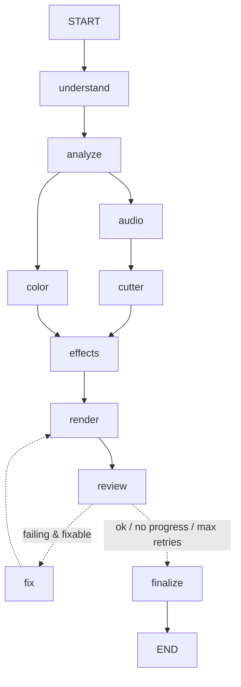

# LangGraph workflow

`backend/cutmind/workflow.py` (LangGraph 1.2). `DirectorAgent.run_job()` runs this graph for every edit.

(`GET /workflow` returns the live Mermaid text.)

| Node | Does | Checkpoint name in the spec |
|---|---|---|
| understand | prompt → Intent (rules or local LLM + keyword guard), memory, AgentRouter | request_understood |
| analyze | per-clip analysis (cached; 4 measurements in parallel, 2 clips at a time); auto-edit plan | media_analyzed |
| audio → cutter, color | plan sections; colour runs in parallel with audio → cutter | plan_created |
| effects | canvas, captions, FX, timed FX, beat punches; merge; length-conflict re-cut | timeline_created |
| render | FFmpeg render (segments in parallel) | render_completed |
| review | checks + scores + lessons; decides fix or finalize | review_completed |
| fix | re-runs only failing agents (+ dependents) with the Reviewer's feedback | — |
| finalize | styled versions if asked, copy output, final scores | final_verified |

**State** (`EditState`) holds JSON only: intent, reference intent, selected specialists, plan sections, plan,
round, retries, history, best result, review, output paths. Live objects (agent context, tracker) are kept in a
runtime table for the duration of the job.

**Checkpoints**: `langgraph-checkpoint-sqlite` → `data/checkpoints.sqlite`, thread id = job id. When the server
starts, jobs left `running` are resumed from their last finished node (`JobManager.restart`, event
`job_resumed`); queued ones start again. Checkpoints of finished jobs are deleted. Tested:
`test_checkpoint_resume_skips_finished_nodes`, `test_server_restart_resumes_an_interrupted_job`.

**Retry policy**: an agent is re-run only if its score is below `SCORE_THRESHOLD`, it has a failed check marked
fixable, and it is under `MAX_AGENT_RETRIES`. If a retry leaves exactly the same checks failing with no better
score, the loop stops (seen on the user's footage: two useless renders before this rule).

**Events**: every node emits `node_started` / `node_completed` (with ms) / `node_failed`; agents emit
`agent_started` / `agent_completed` / `agent_failed`; plus `agents_selected`, `progress`, `log`,
`review_completed`, `render_completed`, `final_ready`, `job_done`, `job_failed`, `job_resumed`.
They stream over SSE from `GET /jobs/{id}/events` (see the live activity panel in the studio).
